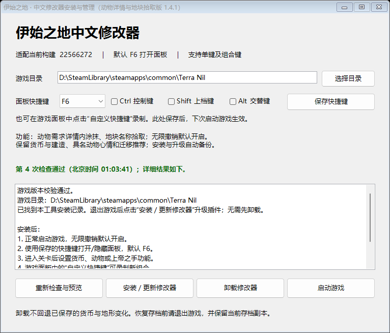

<p align="center">
  <a href="https://store.steampowered.com/app/1593030/Terra_Nil/?l=schinese">
    
  </a>
</p>

<h1 align="center">伊始之地 · 中文修改器</h1>

<p align="center">
  资源与建造 · 动物心情与栖地 · 地形涂抹与拾取
</p>

<p align="center">
  <strong>当前版本 1.5.1</strong> &nbsp;·&nbsp; Windows 64位 &nbsp;·&nbsp; 默认 F6 &nbsp;·&nbsp; MIT（宽松开源许可）
</p>

<p align="center">
  <a href="https://github.com/SiH-zh/Terra-Nil-Trainer/releases/download/v1.5.1/Terra-Nil-Trainer-v1.5.1.zip"><strong>下载完整安装包</strong></a>
  &nbsp; / &nbsp;
  <a href="docs/图文使用教程.md">图文教程</a>
  &nbsp; / &nbsp;
  <a href="docs/使用说明.md">使用说明</a>
  &nbsp; / &nbsp;
  <a href="CHANGELOG.md">更新记录</a>
</p>

《Terra Nil》（伊始之地）的非官方中文修改器，随游戏加载并提供游戏内面板。按真实种群名字设置心情，查看迁移候选，调整建筑与动物范围，也可以用“上帝之手”涂抹地形、辨认当前地块。

## 快速开始

1. 下载 **[1.5.1 完整安装包](https://github.com/SiH-zh/Terra-Nil-Trainer/releases/download/v1.5.1/Terra-Nil-Trainer-v1.5.1.zip)** 并完整解压，保持“伊始之地修改器.exe”与“载荷”目录在一起。
2. 保存进度并退出游戏，运行安装工具，选择实际游戏安装目录。
3. 点击“检查与预览”，通过后点击“安装／更新修改器”。
4. 正常启动游戏并进入关卡，按 **F6** 显示或隐藏中文面板；已有自定义快捷键会保留。

第一次使用建议跟随[图文教程](docs/图文使用教程.md)操作。下载时请选择发布附件中的完整安装包；代码托管平台自动生成的源码压缩包用于开发。

<details>
<summary><strong>查看 1.4.1 安装工具界面</strong></summary>

<p align="center">
  
</p>

图中路径为示例，使用时选择自己的游戏目录。“检查与预览”只检查文件；通过后还需要点击安装按钮。安装器会备份旧插件与找到的存档，不替换原游戏程序集。

</details>

## 功能一览

| 类别 | 功能 | 操作与限制 |
|---|---|---|
| 资源与建造 | 叶子货币 | 设置当前数量0—9999999；不持续锁定。 |
| 资源与建造 | 建筑范围 | 灌溉器、回收器与其他建筑分别设置1—5倍，倍率独立。 |
| 资源与建造 | 建造条件 | 放宽位置及部分条件，仍保留越界、占用和危险检查；货币按原价扣除。 |
| 动物与栖地 | 动物心情 | 按真实种群名字选择，指定种群或全体持续拉满。 |
| 动物与栖地 | 活动范围 | 通用或按物种设置1—5倍，物种独立设置覆盖通用倍率。 |
| 动物与栖地 | 居住地推荐 | 显示物种、种群名字及推荐位置，标记全部预测最高分起点。 |
| 动物与栖地 | 动物高亮 | 持续标记全部兽群与实际可见个体，面板展开或隐藏时均可查看。 |
| 地图与地形 | 上帝之手 | 44种自然地形，圆形或方形笔刷，半径0—8格；整笔一步撤销，可保留动物需求详情。 |
| 气候与环境 | 七项环境滑块 | 在上帝之手页直接设置温度、湿度、毒性、辐射、地质稳定性、大气对流、土壤盐度；可独立恢复自然变化。关卡未启用项禁用；毒性与辐射不清除危险地块。 |
| 地图与地形 | 地块拾取器 | 在上帝之手页独立开关，悬停显示名称、坐标和海拔；可单独使用。 |
| 操作与界面 | 无限撤销 | 从1.4.0起每次启动默认开启，可关闭；只支持原游戏允许撤销的操作。 |
| 操作与界面 | 面板与快捷键 | 边框与四角缩放、标题拖动；默认F6，支持自定义单键或组合键。 |

无限撤销默认开启，其他修改与地块拾取器默认关闭，各种范围默认1倍。表格描述1.5.1功能，历史版本的功能以各自说明为准。

## 1.5.1 更新

- **补齐三项环境参数。** 地质稳定性0～100%、大气对流5～50 U、土壤盐度0～30%，与原有四项合计七个滑块。
- **独立设值与保持。** 拖动立即设定实际数值，支持单项或全部恢复自然变化；关卡未启用的参数禁用。
- **沿用原游戏规则。** 地质稳定性不取消独立地震倒计时，不撤销地震或重置剧情；盐度保持可拦截地图重算，释放后恢复实际地图值。

地质稳定性用于部分城市关卡；大气对流和土壤盐度用于“干旱沙丘”。详情见[环境调节说明](docs/使用说明.md#上帝之手气候调节)。

## 1.5.0 更新

- **四项气候滑块。** 在“上帝之手”页直接设定温度、湿度、毒性和辐射，修改的项目保持目标值，支持单项或全部恢复自然变化。
- **采用实际游戏单位。** 温度−10～50℃、湿度与毒性0～100%、辐射0～500次/分；本关未启用项禁用。修改实际气候并重评估条件，随正常存档保存。
- **保留原有地图工具。** 地形涂抹、地块拾取、动物详情、无限撤销及自定义快捷键继续可用。滑块本身不新增撤销步骤；读档、撤销或切关会清除保持。

毒性与辐射调整全局气候指标，不清除污染地块和辐射源。操作与边界见[气候调节说明](docs/使用说明.md#上帝之手气候调节)，检查结果见[验证记录](docs/验证记录.md)。

## 1.4.1 更新

- **保留动物需求详情涂抹地形。** 打开具体动物的详情后再开启上帝之手，保留所选动物；每笔松开提交后观察需求变化。
- **独立地块拾取器。** 在“上帝之手”页勾选“开启地块拾取器”，鼠标悬停即可查看名称、坐标和海拔，无需同时开启涂抹。

详细操作见[图文教程](docs/图文使用教程.md#六上帝之手涂抹地形)。这些功能已通过隔离回归检查；真实动物需求栏刷新与拾取提示框的可见外观仍需游戏内确认，见[验证记录](docs/验证记录.md)。

## 界面与使用示例

<details open>
<summary><strong>中文面板 · 资源、范围与快捷键</strong></summary>

<p align="center">
  
</p>

此图沿用1.4.0面板预览，尚未进入关卡。图中快捷键为 Ctrl（控制键）+ F6，新安装默认F6；货币与地图操作需要先进入关卡。

</details>

<details>
<summary><strong>按名字选择动物 · 单独保持心情与地图候选</strong></summary>

<p align="center">
  
</p>

示例选择鹿的“清溪家族”。方格地图、球形个体和种群名字来自隔离演示；使用时选择自己地图中的真实种群名字。完整操作见[动物与迁移教程](docs/图文使用教程.md#三指定动物心情与物种范围)。

</details>

## 适配与验证

| 项目 | 当前依据 |
|---|---|
| 系统 | Windows（视窗系统）64位。 |
| 游戏版本 | 1.2.12，游戏平台构建 `22566272`。 |
| 游戏引擎 | Unity（游戏引擎）`2022.3.62f2`，Mono（托管运行环境）版本。 |
| 加载方式 | BepInEx（模组加载框架）随游戏加载，安装器管理插件与加载配置。 |
| 本版验证 | 55项地形与拾取检查、18项原生射线与实际帧检查，及动物、撤销、快捷键、面板和安装回归；详情见[验证记录](docs/验证记录.md)。 |

其他平台与游戏版本尚未全面验证。隔离验证使用人工地图、虚拟输入，并在场景、快照恢复与显示等环节使用夹具；验证记录明确区分已检查行为和仍需真实关卡确认的部分。

## 使用边界与恢复

- **动物与迁移。** 推荐位置按需求与扩张规则估算，不能保证最终心情；扩大范围提高领地容量，仍受适宜地形、地图大小和实际需求限制。
- **地形涂抹。** 保留地块高度，水体外观受关卡规则影响；提交会通过原命令影响气候、进度和自动存档。44种地形的真实素材、长期生态与全部特殊流程尚未全面验收。
- **撤销历史。** 每步保存完整快照并占用内存；读档、阶段变化及不可撤销边界会清空记录。请保留存档备份。
- **更新与卸载。** 先保存并退出游戏，再使用安装工具。存在其他插件时保留共享加载框架；卸载不会自动回退已保存的货币和地形变化。

发布包附 SHA-256（文件校验算法）清单。需要查阅全部规则时，查看[使用说明](docs/使用说明.md)；问题反馈见[参与开发](CONTRIBUTING.md)和[安全说明](SECURITY.md)。

## 从源码编译

<details>
<summary><strong>展开开发环境与编译步骤</strong></summary>

需要本地合法安装的游戏、Windows PowerShell（系统脚本环境）5.1，以及系统 .NET Framework（托管开发框架）的 C#（编程语言）编译器。本仓库不分发游戏依赖程序集。

```powershell
powershell -NoProfile -ExecutionPolicy Bypass -File .\scripts\编译.ps1 -GamePath 'D:\Games\Terra Nil'
```

将示例路径替换为自己的游戏目录。脚本下载官方加载框架并核对固定校验值，也可以通过 `-LoaderZip` 指定事先下载的官方压缩包。仅在仓库的 `.cache` 与 `dist` 中生成文件，不安装或修改游戏。

构建输出是本地开发包，正式对外分发需补齐第三方对应源码与整包校验，见[第三方组件](docs/第三方组件.md)。历史公开包保留原编译脚本；版本标签中的 `scripts/编译.ps1` 使用统一构建方式，C#源码按当版保留。旧版加载与交互问题不会因重新编译自动修复。

</details>

## 版本归档

本仓库保留11个版本，每个标签对应当版源码。首次公开的10个旧版统一归档，相关提交日期为公开归档日期；早期版本作为历史预发布版存档。

[全部发布版](https://github.com/SiH-zh/Terra-Nil-Trainer/releases) · [历史版本与已知问题](docs/历史版本.md) · [变更记录](CHANGELOG.md) · [历史校验清单](docs/历史校验.tsv)

## 游戏主题与品牌

<table>
  <tr>
    <td align="center" width="60%">
      
      <br>
      <sub>中文商店图 · 热浪来袭</sub>
    </td>
    <td align="center" width="40%">
      
      <br>
      <sub>游戏标志 · 带“新生”更新副标题</sub>
    </td>
  </tr>
</table>

这三张游戏品牌图用于识别作品与展示主题，来源和权利范围见[品牌素材说明](docs/品牌素材说明.md)。

## 许可与参与

原创修改器、安装器源码和文档采用 [MIT（宽松开源许可）](LICENSE)，附[中文参考](LICENSE.zh-CN.md)。第三方组件保留各自许可，发布包同时提供 UnityDoorstop（加载入口）对应源码。游戏图片、程序、资源及商标的相关权利归原权利人，本项目为非官方玩家工具。

欢迎通过仓库问题反馈提出复现步骤或功能建议。提交前可先阅读[参与开发](CONTRIBUTING.md)，分享日志和截图时请移除个人信息。
