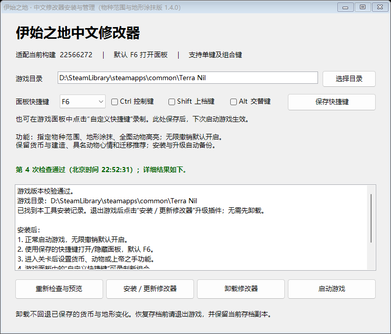
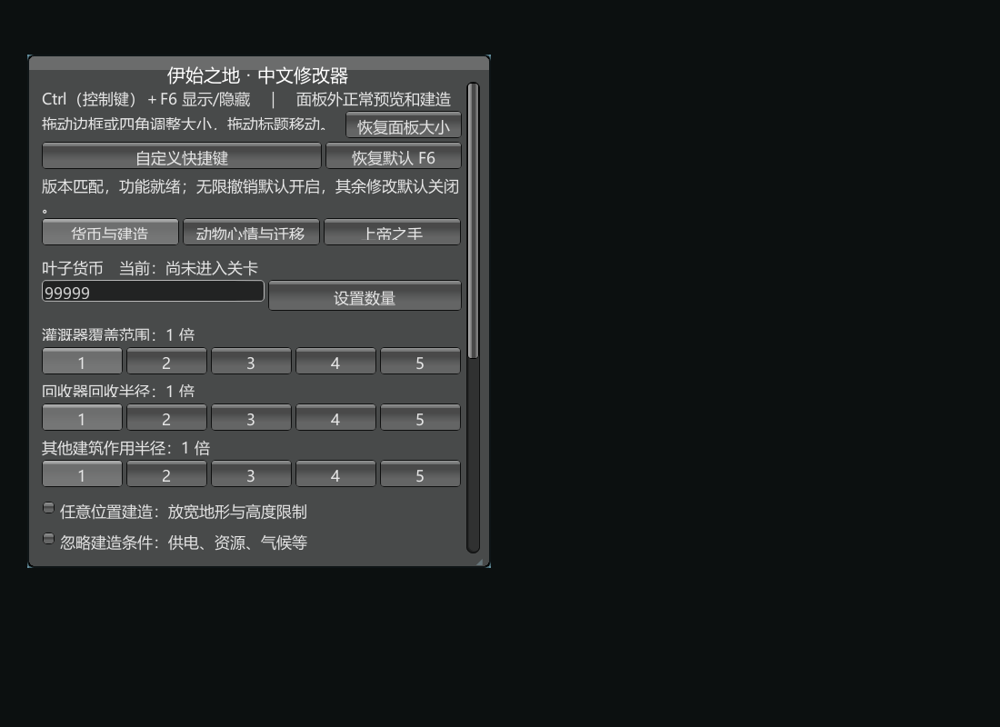
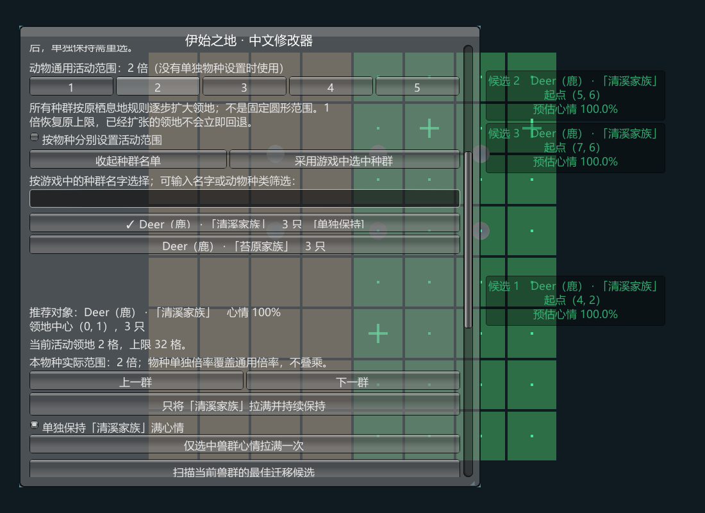
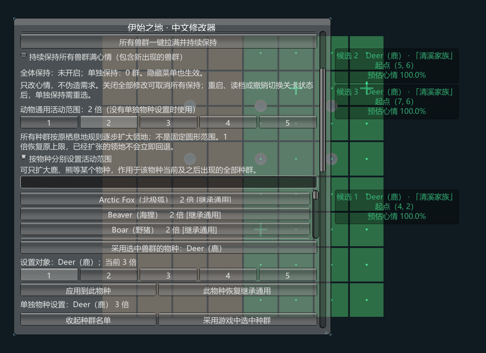
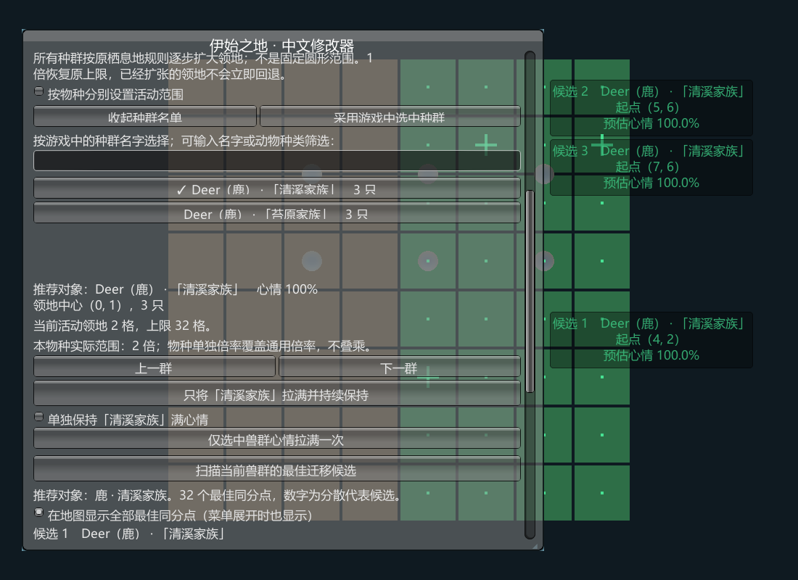
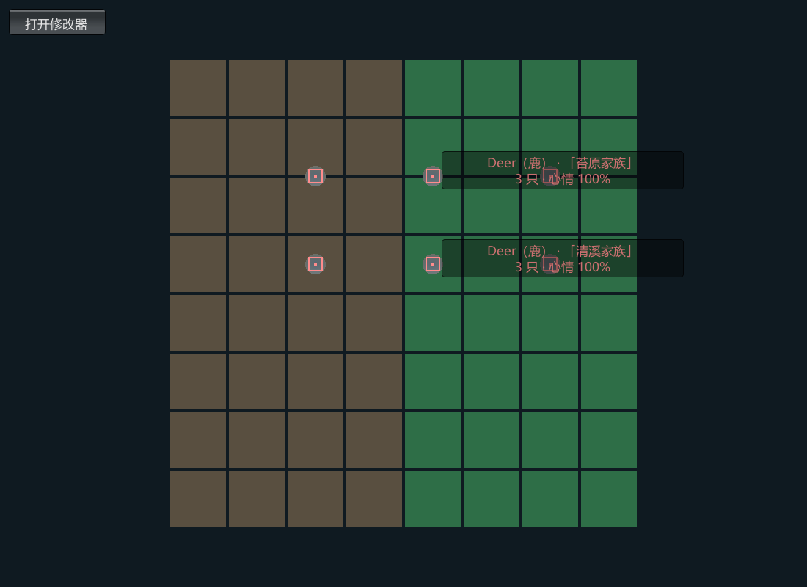
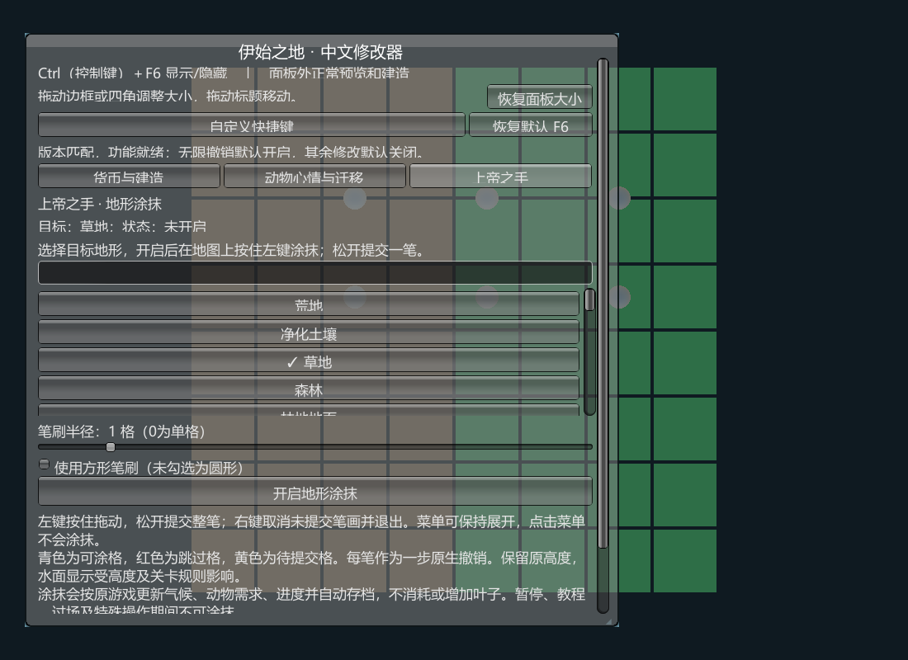
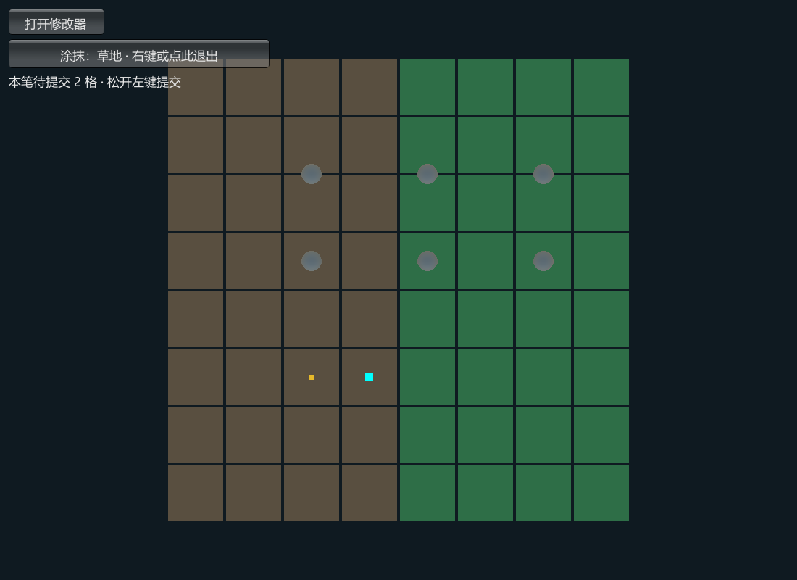
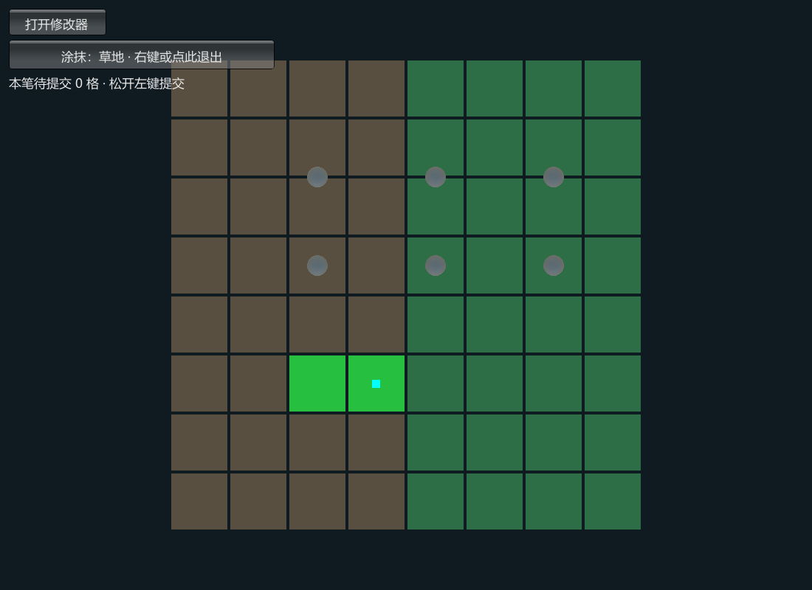
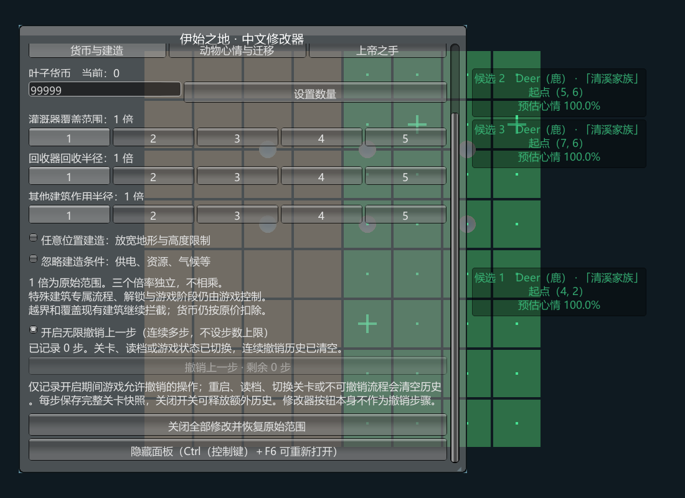

# 伊始之地修改器 1.4.0 图文使用教程

这份教程按“安装 → 打开面板 → 修改资源 → 选择动物 → 修改地图”的顺序介绍常用操作。每个功能可以独立使用，按需开启即可。

图片来自留存的 1.4.0 界面与隔离人工地图预览。方格地图、球形动物和“清溪家族”“苔原家族”是演示用内容；实际游戏的地形、动物模型和种群名字以当前关卡为准。部分图中自定义了 Ctrl（控制键）+ F6，新安装默认快捷键仍是 F6。

## 教程目录

- [一、下载与安装](#一下载与安装)
- [二、面板、快捷键与货币](#二面板快捷键与货币)
- [三、指定动物心情与物种范围](#三指定动物心情与物种范围)
- [四、推荐动物居住地并查看标记](#四推荐动物居住地并查看标记)
- [五、高亮地图上的动物](#五高亮地图上的动物)
- [六、上帝之手：涂抹地形](#六上帝之手涂抹地形)
- [七、无限撤销与关闭修改](#七无限撤销与关闭修改)
- [八、常见问题](#八常见问题)

## 一、下载与安装

1. 打开 [1.4.0 发布页](https://github.com/SiH-zh/Terra-Nil-Trainer/releases/tag/v1.4.0)，在发布附件中下载 `Terra-Nil-Trainer-v1.4.0.zip`。
2. 完整解压，保留以下文件的相对位置：

   ```text
   Terra-Nil-Trainer-v1.4.0/
   ├─ 伊始之地修改器.exe
   ├─ 载荷/
   │  ├─ BepInEx/
   │  ├─ winhttp.dll
   │  ├─ doorstop_config.ini
   │  └─ package.tsv
   ├─ 使用说明.md
   └─ 第三方许可/
   ```

3. 保存进度并退出游戏，运行“伊始之地修改器.exe”。
4. 点击“选择目录”，指定自己的游戏安装目录。目录内应能找到 `Terra Nil.exe`（游戏启动文件）和 `Terra Nil_Data`（游戏数据目录）。
5. 点击“检查与预览”并等待检查完成，阅读结果；通过后点击“安装／更新修改器”。
6. 安装完成后，正常从游戏平台启动游戏并进入关卡。



上图路径是安装工具的示例目录，选择时以自己的实际安装位置为准。检查和预览完成后，还需要点击安装按钮才能写入插件。安装器会备份旧插件及找到的存档，更新时无需先卸载。

## 二、面板、快捷键与货币

### 显示、隐藏和调整窗口

1. 默认按 F6 显示或隐藏面板。使用已保存的自定义键时，按面板顶部显示的组合。
2. 隐藏后可点击左上角“打开修改器”重新显示。
3. 按住标题栏拖动可移动窗口；按住任意边框或四角拖动可调整大小。
4. 面板太小或位置不合适时，点击“恢复面板大小”。

### 更换快捷键

点击“自定义快捷键”，再按想使用的单键或组合键，例如 Ctrl（控制键）+ F6；录制后自动保存。按 Esc（退出键）取消录制，点击“恢复默认 F6”恢复默认。

组合键需要与保存设置匹配；只设 F6 时直接按 F6。若其他软件占用了按键，改成未冲突的组合。也可以在安装工具里选择主键、勾选修饰键并点击“保存快捷键”，下次启动生效。



这是未进入关卡时的面板预览。进入关卡后，货币栏会显示当前数量；图中填写的数值并不表示已经执行了设置。

### 设置货币与建筑范围

1. 进入“货币与建造”页。
2. 输入 0—9999999 之间的整数，点击“设置数量”，观察当前货币变化。
3. 在灌溉器、回收器或其他建筑的倍率行中选择 1—5 倍。
4. 将鼠标移到面板外的地图区域，用原游戏方式预览和放置建筑。

三个建筑倍率独立，1 倍为原始范围。倍率主要作用于之后的预览和操作。任意位置建造与忽略条件需要分别勾选；货币仍按原价扣除，越界、已有建筑及危险格等检查仍保留。

## 三、指定动物心情与物种范围

### 只让一个指定种群持续满心情

1. 进入“动物心情与迁移”页。
2. 若只想影响指定种群，先取消“持续保持所有兽群满心情”。
3. 点击“按名字选择种群”，按动物种类或游戏里的种群名字搜索。
4. 点击需要的那一行，确认下方显示的物种、家族名字、只数和心情。
5. 点击“只将「名字」拉满并持续保持”。
6. 查看该行的“单独保持”标记及对应勾选状态。要停止时，取消该种群的单独保持。



图中两群都是鹿，但名字不同；选择“清溪家族”只针对这一实际种群。可以为多个种群分别开启保持。读档、换关卡、撤销替换状态，或动物离开、合并后，单群保持需要重新选择。

想让全部种群保持满心情，可点击“所有兽群一键拉满并持续保持”，也会覆盖之后出现的兽群。“仅选中兽群心情拉满一次”只写入一次，之后仍可能按环境回落。

### 只扩大某个物种的活动范围

1. 勾选“按物种分别设置活动范围”。
2. 搜索并选择鹿、熊等目标物种，或点击“采用选中兽群的物种”。
3. 选择 1—5 倍，再点击“应用到此物种”。
4. 查看下方“单独物种设置”名单确认生效。
5. 想恢复通用规则时，点击“此物种恢复继承通用”。



例如通用为 2 倍，鹿单独设为 3 倍，鹿最终采用 3 倍，其他未单独设置的物种采用 2 倍。活动范围扩大的是领地格数容量，动物仍按地形和需求逐步扩张；不会立刻形成固定圆形领地。设置作用于当前及之后出现的同种动物，重启后恢复默认。

## 四、推荐动物居住地并查看标记

1. 按第三节的方法选中真实种群，先核对物种和名字。
2. 点击“扫描当前兽群的最佳迁移候选”，等待扫描完成。
3. 查看候选的起点坐标、海拔、扩张预估和预测心情。
4. 点击“定位并标记候选 1”等按钮，把镜头移到相应位置。
5. 根据地图标记，使用游戏原有的迁移操作移动该种群。



绿色小点表示全部预测最高分的同分起点，数字十字表示最多 5 个分散代表点。面板展开时也显示；标记在面板后方被遮住时，可移动或缩小窗口，方便观察地图。

推荐是按原需求与扩张限制得出的估算，不能保证迁移后的最终心情。地图、气候、建筑、领地或范围改变后，应重新扫描；旧预测会标橙。满心情保持不会将推荐评分伪造成满分。

## 五、高亮地图上的动物

1. 在“动物心情与迁移”页点击“一键高亮地图上所有动物”。
2. 按需勾选显示物种和种群名字。
3. 移动镜头查看地图，亮色框会跟随实际可见个体，种群标签显示名字、只数和心情。
4. 再点击同一位置的关闭按钮停止高亮。



球形模型是隔离测试中的示例个体，图片用于说明亮色框和名字标签的位置。真实游戏使用实际动物个体的位置；缺少可见模型时，会明确显示“种群中心”。高亮持续刷新，隐藏面板后也有效，镜头外的动物需要移动镜头查看。

## 六、上帝之手：涂抹地形

### 选择地形与笔刷

1. 进入已加载且未暂停的普通关卡，打开“上帝之手”页。
2. 搜索并选择目标地形，例如“草地”。
3. 设置笔刷半径 0—8 格；0 为单格，可先用单格试画。
4. 默认圆形笔刷，需要方形时勾选“使用方形笔刷”。
5. 点击“开启地形涂抹”，将鼠标移到地图。



### 画一笔、提交与取消

按住左键拖动收集地块，松开左键提交整笔。右键取消当前未提交笔画并退出，也可点击左上角退出按钮。面板可以保持展开，在面板上点击不会开始涂抹；在面板上松开当前笔画会取消该笔。

| 点的颜色 | 含义 |
|---|---|
| 青色 | 当前可涂抹的格子。 |
| 红色 | 建筑、危险区等需要跳过的格子。 |
| 黄色 | 本笔已经收集、等待松开提交的格子。 |



图中顶部提示本笔待提交 2 格，此时尚未提交修改。



图中两个示例地块在松开后改变类型，整笔可作为一步撤销。这些方块是验证用显示，真实关卡的素材、水面等外观由原游戏决定。

笔刷保留高度，跳过已有建筑、管线与危险格。涂抹会通过原游戏命令影响气候、动物需求、进度和自动存档；右键退出只取消未提交部分，已提交的修改需要撤销或恢复存档。暂停、失去焦点、教程、过场及特殊操作期间会退出涂抹并取消未提交笔画。

## 七、无限撤销与关闭修改

1. 1.4.0 每次启动默认勾选“开启无限撤销上一步”。
2. 完成原游戏允许撤销的操作后，在“货币与建造”页查看已记录步数。
3. 点击“撤销上一步”，或使用原游戏撤销按钮，可以连续回退。
4. 每笔地形涂抹按一步记录；想停止额外历史记录，可取消无限撤销勾选。



图中“已记录 0 步”表示此时没有可用历史。每步保存完整快照，会占用内存；重启、读档、换关卡、阶段边界和原不可撤销流程会清空历史。设置货币、心情和倍率本身不单独生成撤销记录。

“关闭全部修改”会关闭保持、高亮、地形工具及无限撤销，并将范围恢复为 1 倍。已经改过的货币和已经完成的地形操作需要另外恢复；下次启动无限撤销仍默认开启。卸载插件也不会自动回退已保存的关卡变化。

## 八、常见问题

| 情况 | 处理方法 |
|---|---|
| 按 F6 没反应 | 点击左上角“打开修改器”；检查是否使用已保存组合键、按键是否被其他软件占用。更新后需要退出并重新启动游戏才能加载新版。 |
| 没有左上角按钮，也没有面板 | 确认完整解压并完成安装；查看游戏目录的 `BepInEx/LogOutput.log`（加载日志）中是否加载了 1.4.0。如失败，记录脱敏后的日志再反馈。 |
| “检查与预览”通过，游戏里仍没插件 | 检查后还需要点击“安装／更新修改器”，并确认选择的是当前启动的游戏目录。 |
| 单次拉满后心情回落 | 使用“拉满并持续保持”，确认全体或对应种群保持勾选已开启。 |
| 推荐坐标看不见或位置变化 | 点击候选定位、移动或缩小面板；地图或范围变化后重新扫描，推荐属于估算。 |
| 倍率已经应用，动物没立刻扩张 | 倍率提高领地容量，扩张仍受地形和需求限制；已经满足需求时不一定继续扩张。 |
| 建筑没预览或无法放置 | 将鼠标移到面板外，检查是否还开着地形涂抹；涂抹期间暂停原地图选择和建造。 |
| 地形笔刷不能开启 | 进入普通关卡，结束暂停、教程、过场或特殊操作；建筑及危险格会跳过。 |
| 海洋或冰面效果不符合预期 | 笔刷保留高度，视觉受原关卡水面和规则影响；先在备份后的少量格子上试用。 |
| 撤销按钮显示 0 步 | 原允许撤销的操作才会记录，读档或不可撤销边界会清空；设置按钮本身不产生步骤。 |

完整规则见[使用说明](使用说明.md)，测试范围见[验证记录](验证记录.md)，旧版问题见[历史版本](历史版本.md)。反馈时提供游戏版本、修改器版本和复现步骤，并删除日志或截图里的个人信息。
